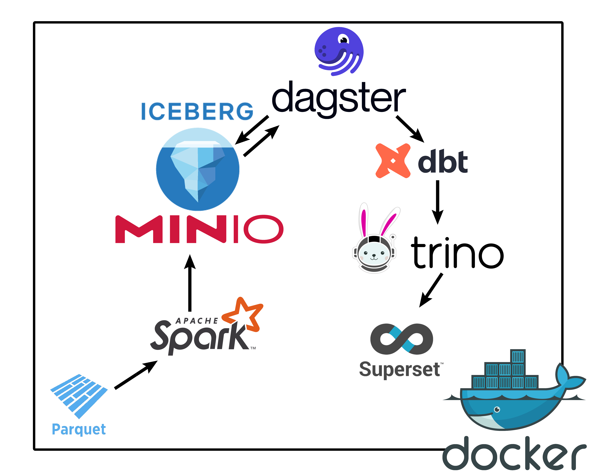

# Information

This project features a local data lakehouse pipeline/platform architecture.
The project is fully contained within a Docker environment to ensure safe practices and local functionality.
The goal of the project is to create a scalable, open-source lakehouse pipeline that can function as an alternative to more expensive vendor solutions.

# Background

I'm a cs bachelors student. As a cs student, it's always fascinating to drive into new topics, areas and test out tools you haven't had the chance to at your formal studies. This project is such a case. It's been the largest cs project I have done in my entire studying+hobbyist career, and has taken many months and hundreds of hours of work and debugging.

I started this project to learn Iceberg and Spark in Docker, but eventually it grew out into a full lakehouse platform. I have learned a great deal building this project, most notably how to work with Docker and different AI/LLM tools for better production and debugging. The project has not been easy to make, and especially trying to understand how tools like dbt and Dagster work takes a lot of time and studying. The AI tools I've used, especially Claude, have been really helpful with both the learning and debugging parts. Without such tools, it would have been near impossible for a cs student like me to build a project like this. However, no part of this project has been written without my personal oversight. Any serious developer/engineer understands that AI is just a tool and cannot be responsible for the major decisions or debugging of a project. 

# Requirements and installations

This project requires the use of Docker. You can install Docker at https://docs.docker.com/engine/install/.

The dataset used in this project is found at https://www.kaggle.com/datasets/ahmedelsayedrashad/airline-on-time-performance-data.
You should install the dataset locally and extract it into the /data subfolder in the project. 

Other installations are done via the docker-compose file. 

To start up the project, you need to open a CLI at the project folder and type 'docker-compose up'. That will start all the necessary services. If you have issues starting the Dagster service again, it's recommended to restart your computer to clear network cache. 

After that, you can run the script that gets data from the raw .parquet dataset into the Iceberg REST catalog database by running command 'docker exec -it spark-iceberg spark-submit /home/iceberg/notebooks/ingest.py'. Note that this command can be quite CPU heavy, so check that you have high enough CPU and memory limits in Docker.

You can also run a script that will create a partition by day for Iceberg. This can be useful for a lot of ad hoc queries for data upstream. 'docker exec -it spark-iceberg spark-submit /home/iceberg/notebooks/partitions.py' is the command. 

Now that the data is in Iceberg, the next step is to enable workflow orchestration for the lakehouse. This is done via Dagster. Your local Dagster is located at http://localhost:3000 (open that in your browser). Inside the Dagster visual environment, go to the 'Automation' page, then set 'Running' slider on. This will set up the sensors that check for new Iceberg snapshots every 30 seconds and send dbt models downstream. This process is even more CPU heavy, since it sends a dbt star schema downstream, and requires several minutes to run. 

The Dagster jobs for the dbt star schema and the data quality tests have been optimized to run around 15 minutes. The data quality tests ensure that all the rows are within valid ranges and that there are no data leakages. 

You should now also considering adding or removing new flights to the data table. This can be done via Python scripts 'docker exec -it spark-iceberg spark-submit /home/iceberg/notebooks/add_flight.py' and 'docker exec -it spark-iceberg spark-submit /home/iceberg/notebooks/remove_flight.py'. Both of these scripts will create a new Iceberg snapshot, which the Dagster jobs should be able to detect. These will then create new star schemas downstream. 

After the first Dagster jobs have finished running, you can go to Superset for data analytics. Your local Superset is at http://localhost:8088. Login with username admin and password admin. Inside Superset, go to 'Settings' -> 'Database Connections'. Click '+Database', select 'Trino' from the list. Paste 'trino://admin@trino:8080/iceberg' into the SQLAlchemy URI text field, test connection and after that you can connect to the database.

As you can notice, Trino, and thus Superset users, can only access the 'default' namespace which has the dbt models. This is to ensure that the analysts only get the quality data from the downstream.

# About the choice of tools

While a lot of modern data engineering is very cloud heavy, utilizing tools like Databricks, AWS, Azure etc. has it's downsides. One of them is customizability. Many vendors offer 'one size fits all' solutions that make it hard to work with edge cases and smaller, local, ecosystems. However, it's entirely possible to replicate many of the functionalities that cloud environments can offer. The main drawback is often cost of computation, especially when working with large - big data. But that problem can also be solved using smart distributed and parallel computing. 

Iceberg has become a big name in open table format analytics. One of the main reasons Iceberg has become so popular, and why it is used here, is the time travel and snapshot functionality. Every time changes at the REST catalog level are made (such as deleting a table), a new snapshot is created that includes the timestamp, id, etc.. It's possible to query from past snapshots, which makes certain operations much more accessible.

This project uses Trino because it's a great open-source query engine that has a solid Iceberg connector and Superset supports it. Trino is also great for ad hoc queries if you wish to perform those on the star schemas. 

The obvious downside of using a local platform like this is speed. It takes a lot of CPU power to do the computations for even this medium size dataset, so that's where cloud vendors still win. But it's an example that open-source, local platforms can provide the same functionalities as cloud vendors. 

The architecture is explained in this visualization:

# Conclusion

The pipeline/data platform here could be seen as an example of modern analytics engineering. The main point of such a pipeline is to get raw data into a data warehouse/lake/lakehouse, then send it downstream for analytics. The special functionality of this lakehouse is the Dagster orchestration via Iceberg snapshots. This allows for a fluid analytics pipeline where you can access new data from every new snapshot. The kind of architecture used here can be scaled up to real time and larger datasets with Flink, Kafka and cloud vendors (like Databricks). 

The main point is to use the three part architecture (data upstream/storage -> orchestration -> downstream/analytics). The tools used for each part can be changed depending on what the goal of the pipeline is, but secure, modern and flexible tools like Iceberg and Dagster always make a difference. 

## Applications

The pipeline here can be applied to different uses cases, especially in business and logistics, such as e-commerce, sales management, transport logistics, etc.. The flight management pipeline here in terms of analytics is very barebones, as the main focus has been on the choice of tools and the platform architecture. Most production ready pipelines would feature much more advanced ETL/ELT, upstream queries and data analytics. 